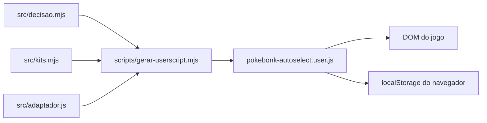

# Arquitetura

`decidir` recebe uma descrição de tela e retorna uma ação. O adaptador observa o DOM, reconhece cartões e botões e chama `decidir`, executando cliques quando ativo. O gerador combina as fontes em um userscript independente. `localStorage` guarda cinco presets e o preset ativo; a ativação é mantida apenas em memória e começa desligada.

O adaptador guarda avisos de seleções fora da build em `sessionStorage` da aba, com fallback em memória, até o usuário marcá-los como resolvidos. Ele observa o desaparecimento do cartão, mas não comprova a aquisição ou a remoção pelo Hypno.

Para banimento de kit, o adaptador tenta ler os módulos do jogo carregados na mesma origem e os planos de build disponíveis no `localStorage`. `kitPodeSerBanido` compara o kit com todos os planos encontrados, sem transmitir os planos. Se não for possível comprovar a segurança, o adaptador usa banimento individual.

O DOM do jogo é externo e pode mudar sem aviso. Não há serviço ou banco próprio neste repositório. Veja [contratos](contracts.md) e [decisões](decisions/README.md).

O Auto Pickup possui ativação separada em memória. A decisão de elegibilidade e as estimativas de gasto são puras; o adaptador lê o aviso e a carteira, emite eventos de teclado e acompanha as telas do cassino e da loja que ele mesmo abriu.

O reconhecimento dos estágios do Rugido de Rhydon fica na decisão; o adaptador limita e espaça as tentativas para cada estágio visível.

A elegibilidade das Ruínas do Fóssil e a escolha do Domo ficam nas regras puras; o adaptador reconhece o cartão e executa a interação e o clique.

Durante um giro no cassino, o adaptador tenta pular a animação e reavalia o próximo giro. Se identificar uma tela de recompensa, tenta retomar a visita após a escolha.

Quando ativo, o botão do Auto Pickup mostra uma sugestão de destino mantida em memória até ser concluída ou trocada pelo usuário. A sugestão não limita as interações pagas no caminho. Nos modais próprios, indica que está avaliando itens ou giro.

O painel de mapa captura a instância de marcadores envolvendo o método da classe interna carregada pelo jogo; a extração e a projeção são conservadoras quando a versão ou os dados não são reconhecidos. O adaptador identifica a tela Alfa, e a escolha entre bônus é uma regra pura em `decisao.mjs`.

O catálogo compartilhado de atributos no adaptador reconhece cura como entrada independente para leitura e ordenação dos bônus.

A automação de Fenda usa a instância de partida já capturada para o painel de mapa e consulta as verificações de bloqueio do jogo antes de enviar C ou reconhecer sua entrada.

Os controles e o painel de mapa ficam no lado esquerdo; o adaptador ajusta sua altura abaixo da equipe visível e limita a altura da lista. Os avisos de itens fora da build ficam afastados do canto inferior direito.
