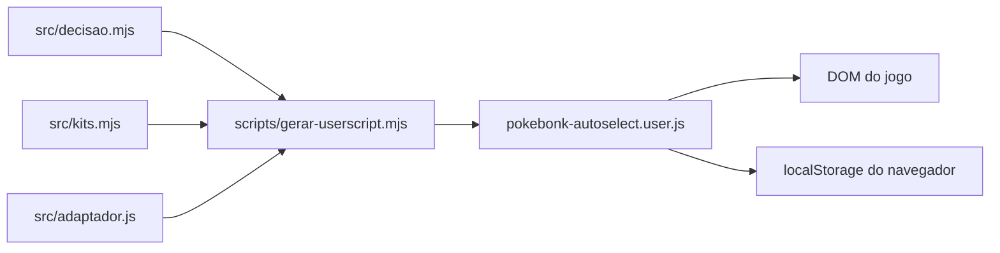

# Arquitetura

`decidir` recebe uma descrição de tela e retorna uma ação. O adaptador observa o DOM, reconhece cartões e botões e chama `decidir`, executando cliques quando ativo. O gerador combina as fontes em um userscript independente. `localStorage` guarda cinco presets e o preset ativo; a ativação é mantida apenas em memória e começa desligada.

O adaptador guarda avisos de seleções fora da build em `sessionStorage` da aba, com fallback em memória, até o usuário marcá-los como resolvidos. Ele observa o desaparecimento do cartão, mas não comprova a aquisição ou a remoção pelo Hypno.

Para banimento de kit, o adaptador tenta ler os módulos do jogo carregados na mesma origem e os planos de build disponíveis no `localStorage`. `kitPodeSerBanido` compara o kit com todos os planos encontrados, sem transmitir os planos. Se não for possível comprovar a segurança, o adaptador usa banimento individual.

O DOM do jogo é externo e pode mudar sem aviso. Não há serviço ou banco próprio neste repositório. Veja [contratos](contracts.md) e [decisões](decisions/README.md).

O Auto Pickup possui ativação separada em memória. A decisão de elegibilidade e as estimativas de gasto são puras; o adaptador lê o aviso e a carteira, emite eventos de teclado e acompanha as telas do cassino e da loja que ele mesmo abriu.

Durante um giro no cassino, o adaptador identifica o botão de pular animação e tenta acioná-lo; o próximo giro continua condicionado à decisão de gasto.

Quando ativo, o botão do Auto Pickup mostra uma sugestão de destino mantida em memória até ser concluída ou trocada pelo usuário. A sugestão não limita as interações pagas no caminho. Nos modais próprios, indica que está avaliando itens ou giro.
