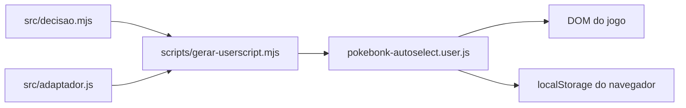

# Arquitetura

`decidir` recebe uma descrição de tela e retorna uma ação. O adaptador observa o DOM, reconhece cartões e botões e chama `decidir`, executando cliques quando ativo. O gerador combina as fontes em um userscript independente. `localStorage` guarda cinco presets e o preset ativo; a ativação é mantida apenas em memória e começa desligada.

O DOM do jogo é externo e pode mudar sem aviso. Não há serviço ou banco próprio neste repositório. Veja [contratos](contracts.md) e [decisões](decisions/README.md).
