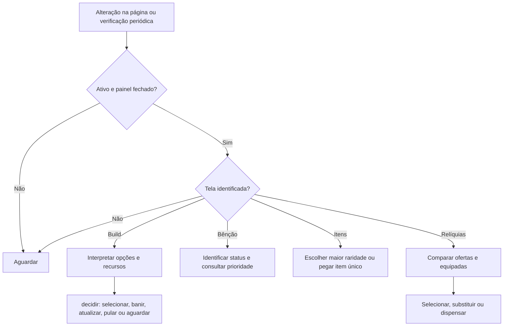

# Fluxos

1. `MutationObserver` e verificação periódica agendam `observar`, em `src/adaptador.js`.
2. O adaptador lê elementos visíveis e encaminha opções para `decidir` em `src/decisao.mjs`.
3. Para banir, primeiro ativa o modo de banimento e escolhe o alvo. Na confirmação, confere os nomes e a ausência de marcadores do plano. Se houver botão de kit e a comparação com os planos comprovar que o kit é seguro, aciona o botão de kit; caso contrário, clica novamente no mesmo cartão para confirmar o banimento individual. Confirmações iniciadas manualmente são deixadas para o jogador.
4. Se a tela ou os dados necessários não forem reconhecidos, o adaptador ou a decisão aguardam. Não há códigos HTTP próprios.

Ao interpretar a tela de nível, melhorias identificadas como fusões equipadas são elegíveis como golpes, inclusive quando o jogo não exibe o selo do plano.

Na ausência de opção do plano, a decisão prioriza melhorias já adquiridas; sem elas, tenta banir, atualizar e pular. Se os três contadores forem reconhecidos como esgotados, escolhe uma opção aleatória. Quando um cartão escolhido fora do plano deixa a tela, o adaptador mostra um aviso até o usuário marcá-lo como resolvido. O desaparecimento do cartão não garante que o jogo aceitou a escolha; o aviso pede conferência.

Na tela de relíquias, `observarReliquias` confere o número de espaços e interpreta os atributos das ofertas e das equipadas. A escolha considera a raridade e, em seguida, o atributo mais prioritário no preset ativo. Com espaços cheios, compara antes de escolher e volta a comparar na tela de substituição; se os dados forem incompletos, aguarda.

Se uma seleção de cartão permanecer na tela após um clique, o adaptador tenta o mesmo cartão até três vezes, com intervalo mínimo de 500 ms. Banir, atualizar e pular não recebem essa repetição automática.

No painel de prioridades, `abrirPrioridades` permite trocar entre cinco presets, editar o nome e reordenar com a alça ou com botões. Para copiar, selecione outro preset em **Copiar de** e confirme a substituição da ordem do preset ativo; o nome e a ordem da origem não mudam. A troca, a cópia e cada movimento salvam a configuração em `localStorage`; o nome é salvo quando o campo perde o foco. Uma configuração anterior de prioridade serve como ponto de partida para os presets.

Os seletores e etapas são dependências da interface real; a simulação em `tests/integracao.test.mjs` não confirma o comportamento do jogo.

O Auto Pickup independente observa o aviso de proximidade. Com a tecla E identificada e sem modal aberto, emite um pressionamento para textos gratuitos explicitamente reconhecidos e para jaulas identificadas pelo aviso de libertação por 30 ₽; para Pokébola e cassino confere o preço do aviso com o HUD e o saldo. A sugestão de destino usa a estimativa documentada em produto, mas não bloqueia as outras interações pagas reconhecidas no caminho. Na loja compra o lote disponível se houver saldo e depois decide se renova usando os preços e raridades observados; se renovar, reavalia o lote real. No cassino tenta um giro inicial quando há saldo e reavalia os próximos. Só assume o controle de lojas e cassinos que ele próprio abriu. Portais e avisos desconhecidos permanecem manuais.

O altar amaldiçoado é acionado uma vez por aviso. Para Rhydon, os avisos inicial, 1/3 e 2/3 permitem tentar a próxima ativação; cada estágio recebe no máximo três tentativas espaçadas de 800 ms enquanto o mesmo aviso continuar. Um aviso de altar esgotado não é acionado.

Com o Auto Pickup ligado, o botão exibe a sugestão para procurar no mapa ou uma mensagem de espera quando faltam dados ou saldo. Ela permanece fixa durante o trajeto e após interações fora da sugestão; é liberada quando a interação sugerida termina, muda a zona, uma nova partida é identificada ou o usuário usa **Trocar sugestão**. Após sair da loja, ela não volta a ser sugerida por 30 segundos. Uma interação paga concluída não é repetida enquanto seu aviso permanecer próximo. Durante os modais de loja e cassino abertos pelo script, o botão mostra que está avaliando a situação.

Depois de ler preços e raridades na loja, a estimativa observada permanece disponível por até 60 segundos na mesma zona para decisões no mapa e no cassino. É descartada ao identificar outra zona, uma nova partida pelo relógio ou ausência do HUD. No cassino, o script tenta pular a animação pelo botão identificado, com até três tentativas espaçadas; espera seu término para decidir o próximo giro. Um clique de giro ignorado também recebe até três tentativas por estado reconhecido; o contador diferencia rodadas quando preço e saldo exibidos não mudam.
