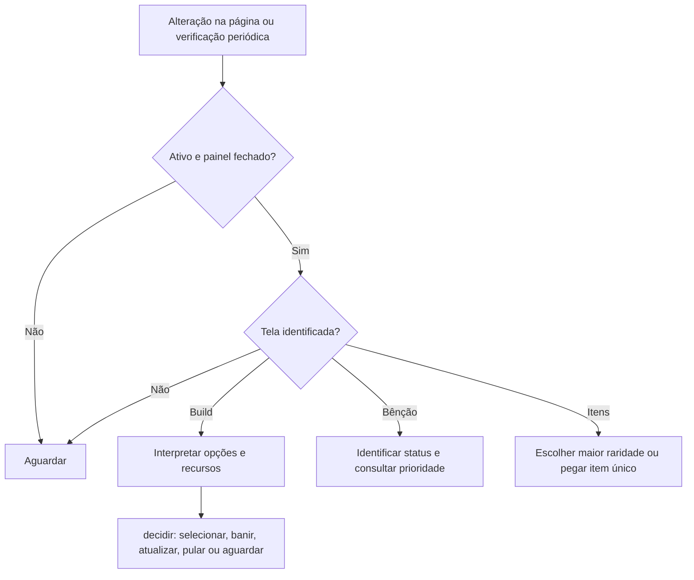

# Fluxos

1. `MutationObserver` e verificação periódica agendam `observar`, em `src/adaptador.js`.
2. O adaptador lê elementos visíveis e encaminha opções para `decidir` em `src/decisao.mjs`.
3. Para banir, primeiro ativa o modo de banimento; depois confere os nomes e a ausência de marcadores do plano antes de clicar no alvo.
4. Se a tela ou os dados necessários não forem reconhecidos, o adaptador ou a decisão aguardam. Não há códigos HTTP próprios.

Os seletores e etapas são dependências da interface real; a simulação em `tests/integracao.test.mjs` não confirma o comportamento do jogo.
