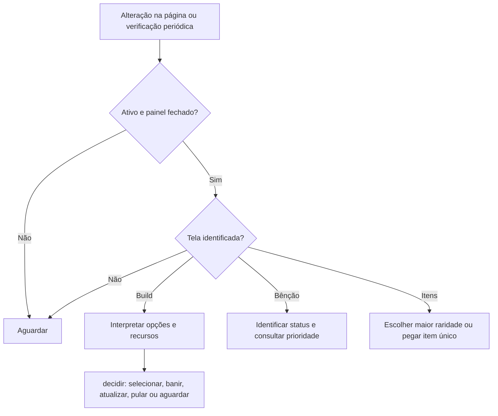

# Fluxos

1. `MutationObserver` e verificação periódica agendam `observar`, em `src/adaptador.js`.
2. O adaptador lê elementos visíveis e encaminha opções para `decidir` em `src/decisao.mjs`.
3. Para banir, primeiro ativa o modo de banimento; depois confere os nomes e a ausência de marcadores do plano antes de clicar no alvo.
4. Se a tela ou os dados necessários não forem reconhecidos, o adaptador ou a decisão aguardam. Não há códigos HTTP próprios.

Ao interpretar a tela de nível, melhorias identificadas como fusões equipadas são elegíveis como golpes, inclusive quando o jogo não exibe o selo do plano.

Se uma seleção de cartão permanecer na tela após um clique, o adaptador tenta o mesmo cartão até três vezes, com intervalo mínimo de 500 ms. Banir, atualizar e pular não recebem essa repetição automática.

No painel de prioridades, `abrirPrioridades` permite trocar entre cinco presets, editar o nome e reordenar com a alça ou com botões. Para copiar, selecione outro preset em **Copiar de** e confirme a substituição da ordem do preset ativo; o nome e a ordem da origem não mudam. A troca, a cópia e cada movimento salvam a configuração em `localStorage`; o nome é salvo quando o campo perde o foco. Uma configuração anterior de prioridade serve como ponto de partida para os presets.

Os seletores e etapas são dependências da interface real; a simulação em `tests/integracao.test.mjs` não confirma o comportamento do jogo.
