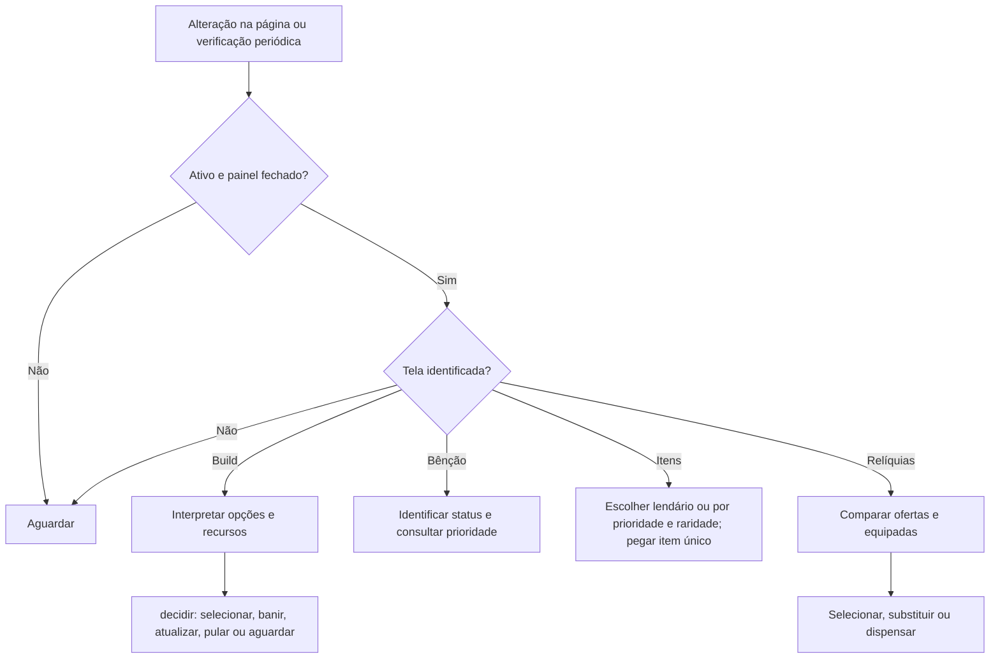

# Fluxos

1. `MutationObserver` e verificação periódica agendam `observar`, em `src/adaptador.js`.
2. O adaptador lê elementos visíveis e encaminha opções para `decidir` em `src/decisao.mjs`.
3. Para banir, primeiro ativa o modo de banimento e escolhe o alvo. Na confirmação, confere os nomes e a ausência de marcadores do plano. Se houver botão de kit e a comparação com os planos comprovar que o kit é seguro, aciona o botão de kit; caso contrário, clica novamente no mesmo cartão para confirmar o banimento individual. Confirmações iniciadas manualmente são deixadas para o jogador.
4. Se a tela ou os dados necessários não forem reconhecidos, o adaptador ou a decisão aguardam. Não há códigos HTTP próprios.

Ao interpretar a tela de nível, melhorias identificadas como fusões equipadas são elegíveis como golpes, inclusive quando o jogo não exibe o selo do plano.

Na ausência de opção do plano, a decisão prioriza melhorias já adquiridas; sem elas, tenta banir, atualizar e pular. Se os três contadores forem reconhecidos como esgotados, escolhe uma opção aleatória. Quando um cartão escolhido fora do plano deixa a tela, o adaptador mostra um aviso até o usuário marcá-lo como resolvido. O desaparecimento do cartão não garante que o jogo aceitou a escolha; o aviso pede conferência.

Na tela de relíquias, `observarReliquias` confere o número de espaços e interpreta os atributos das ofertas e das equipadas. A escolha considera a raridade e, em seguida, o atributo mais prioritário no preset ativo. Com espaços cheios, compara antes de escolher e volta a comparar na tela de substituição; se os dados forem incompletos, aguarda.

Na tela de escolha de power-ups, o adaptador lê os bônus diretos no início da descrição e a raridade. A decisão escolhe um lendário quando há algum; caso contrário ordena pelo melhor atributo reconhecido do preset e pela raridade. Itens sem atributo reconhecido ficam após os reconhecidos e, se nenhum tiver atributo reconhecido, prevalece a raridade. Sem lendário reconhecido, uma raridade desconhecida faz aguardar.

Se uma seleção de cartão permanecer na tela após um clique, o adaptador tenta o mesmo cartão até três vezes, com intervalo mínimo de 500 ms. Banir, atualizar e pular não recebem essa repetição automática.

No painel de prioridades, `abrirPrioridades` permite trocar entre cinco presets, editar o nome e reordenar com a alça ou com botões. Para copiar, selecione outro preset em **Copiar de** e confirme a substituição da ordem do preset ativo; o nome e a ordem da origem não mudam. A troca, a cópia e cada movimento salvam a configuração em `localStorage`; o nome é salvo quando o campo perde o foco. Uma configuração anterior de prioridade serve como ponto de partida para os presets.

Os seletores e etapas são dependências da interface real; a simulação em `tests/integracao.test.mjs` não confirma o comportamento do jogo.

O Auto Pickup observa o aviso de proximidade e interage apenas com textos identificados, inclusive para chamar o Alfa e encerrar as ondas. A sugestão prioriza Pokébolas, sem bloquear outras interações reconhecidas. Na loja, compra lotes inteiros e renova repetidamente enquanto viáveis; no cassino, avalia cada giro e tenta retomar após uma recompensa reconhecida. Preserva o custo estimado das Pokébolas pagas restantes que cabem no saldo atual e usa o dobro do custo estimado dela como limite por item. Portais do chefe, da próxima zona e avisos desconhecidos permanecem manuais.

A conferência usa o preço bruto da carteira quando o HUD exibe um valor abreviado; sem preço bruto, só aceita valores exibidos por inteiro. Um preço incompatível ou saldo insuficiente mantém a interação em espera.

O altar amaldiçoado é acionado uma vez por aviso. Para Rhydon, os avisos inicial, 1/3 e 2/3 permitem tentar a próxima ativação; cada estágio recebe no máximo três tentativas espaçadas de 800 ms enquanto o mesmo aviso continuar. Um aviso de altar esgotado não é acionado.

Nas Ruínas do Fóssil, o pickup envia E para o aviso reconhecido e seleciona o cartão de Domo quando nome, benefício e custo coincidem. A seleção também funciona se a tela for aberta manualmente com o pickup ligado; cartões ausentes, duplicados, desabilitados ou diferentes aguardam.

Com o Auto Pickup ligado, o botão exibe a sugestão para procurar no mapa ou uma mensagem de espera quando faltam dados ou saldo. Ela permanece fixa durante o trajeto e após interações fora da sugestão; é liberada quando a interação sugerida termina, muda a zona, uma nova partida é identificada ou o usuário usa **Trocar sugestão**. Após sair da loja, ela não volta a ser sugerida por 30 segundos. Uma interação paga concluída não é repetida enquanto seu aviso permanecer próximo, exceto na retomada do cassino após recompensa reconhecida. Durante os modais de loja e cassino abertos pelo script, o botão mostra que está avaliando a situação.

Depois de ler preços e raridades na loja, a estimativa observada permanece disponível por até 60 segundos na mesma zona para a sugestão. No cassino, o script tenta pular cada animação e avalia o próximo giro, com até três tentativas por estado. O retorno após recompensa depende de reconhecer a tela de escolha ou item único e tolera uma breve transição entre telas; a integração precisa de teste em jogo.

O painel de mapa é independente dos controles de ativação e pode ser recolhido com um clique. Captura a lista de marcadores do jogo e atualiza a contagem e a reserva quando os dados são reconhecidos. Com o pickup ativo, a tela de substituição de Alfa compara os bônus do novo e dos existentes com o preset ativo; se qualquer informação essencial for ambígua, não escolhe.

A comparação reconhece também o bônus de cura mostrado nos cartões; sua posição é configurável no preset e não é confundida com regeneração.

Na tela reconhecida de um único brilhante, o adaptador exige exatamente dois cartões, um existente e um novo, e aplica a mesma comparação de prioridades usada para Alfa. Se faltar informação ou houver ambiguidade, aguarda.

Quando o pickup está ligado, a Fenda é aberta com C se o HUD e o estado do jogo confirmarem a disponibilidade. O script aguarda situações bloqueadas e tenta novamente; ao passar pela entrada confirmada da Fenda, interage com E.

Ao encontrar o aviso reconhecido para chamar uma onda, o pickup tenta antecipá-la com E. Cada texto de onda é acionado uma vez enquanto permanece visível.

Os controles e a lista de mapa aparecem à esquerda, com a posição vertical ajustada à equipe visível. A lista continua recolhível e pode rolar quando não couber no espaço disponível.
